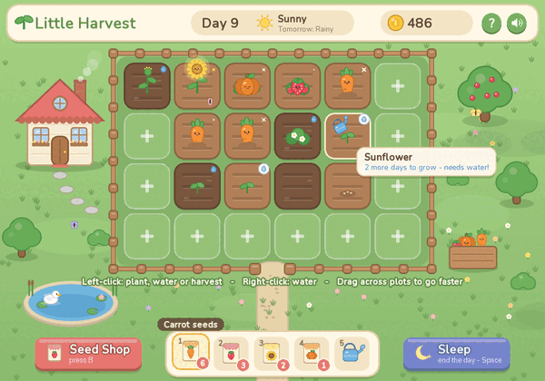
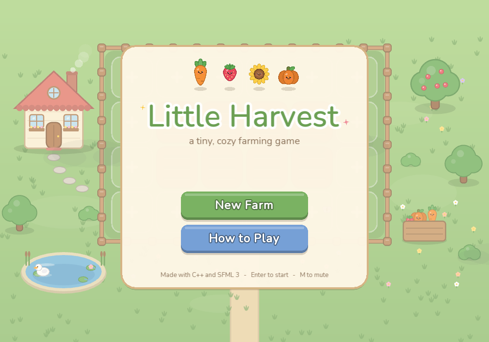
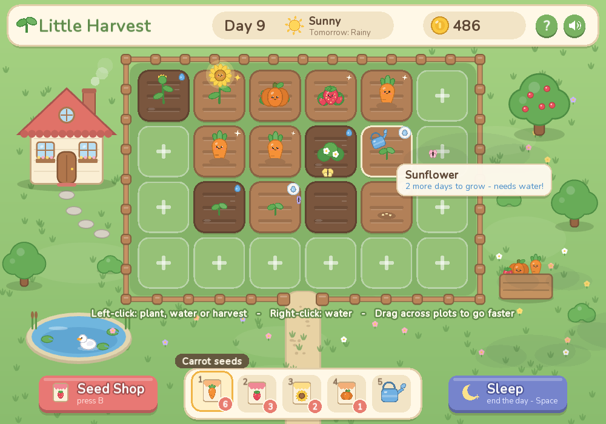
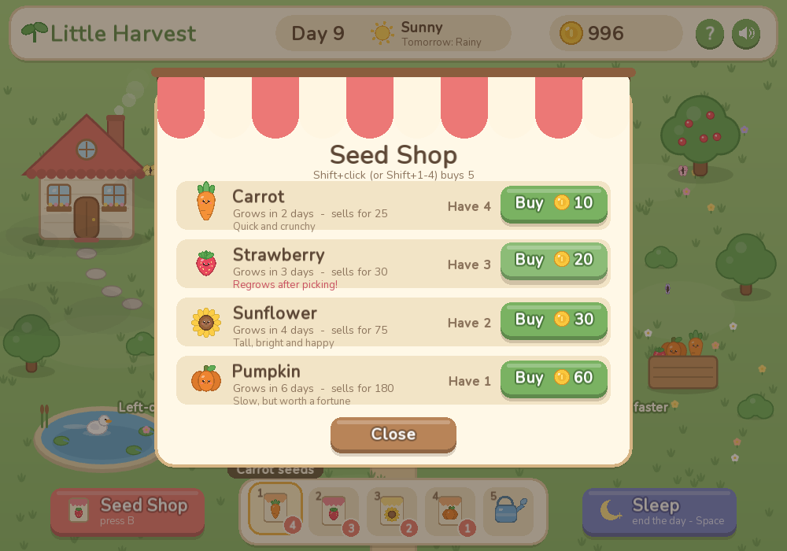
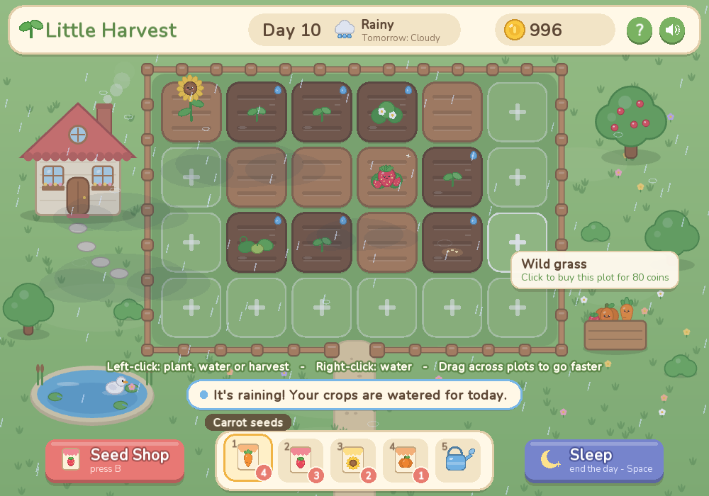

# 🥕 Little Harvest

A tiny, cozy farming game written in **C++17** with **SFML 3**.
Plant seeds, water your crops, sleep through the night, and watch your little farm grow.

All of the art is drawn in code from simple SFML shapes, and every sound effect is synthesised when the game starts. The only asset file is the font.



<p align="center">
  
  
  
  
</p>

## Features

- **Four crops**, each with its own look, price and growing time. They all have little faces.
- **Grow by watering**: a crop grows one step for every night it was watered. Thirsty plants show a small bubble.
- **Day and night**: sleep to start a new day, with a starry fade and a morning summary.
- **Weather and forecast**: sunny, cloudy and rainy days. Rain waters every crop for you, and the HUD shows tomorrow's weather so you can plan ahead.
- **Seed shop** with an awning, and **land expansion**: buy new plots as you earn, each one costing a bit more.
- **Golden crops**: an 8% chance that a crop ripens golden and sells for **3x**.
- **A goal**: save up 1,000 coins to win the *Golden Harvest Ribbon* (with confetti 🎉).
- **Drag to farm**: hold the mouse and sweep across plots to plant, water or harvest a whole row.
- **Autosave**: the farm saves every morning and when you quit. Continue from the title screen.
- **Small touches**: coins fly to your wallet, particles and sparkles, chimney smoke, a duck on the pond, butterflies, drifting cloud shadows, hover tooltips, a custom window icon, and an F12 screenshot key.

## Crops

| Crop | Seed cost | Sells for | Days to grow | Notes |
|------|----------:|----------:|-------------:|-------|
| 🥕 Carrot | 10 | 25 | 2 | Quick and cheap, good for starting out |
| 🍓 Strawberry | 20 | 30 | 3 | **Regrows** every 2 days after picking |
| 🌻 Sunflower | 30 | 75 | 4 | |
| 🎃 Pumpkin | 60 | 180 | 6 | Slow, but worth a fortune |

## Controls

| Action | Input |
|--------|-------|
| Choose seeds / watering can | `1`–`5`, mouse wheel, `Tab`, or click the toolbar |
| Plant, water or harvest | Left-click a plot (hold and drag to do many) |
| Water | Right-click a plot |
| Buy land | Left-click a `+` tile |
| Seed shop | `B` (in the shop: `1`–`4` to buy, `Shift` to buy 5) |
| Sleep / next day | `Space` or the Sleep button |
| How to play | `H` or the `?` button |
| Mute | `M` |
| Screenshot | `F12` (saves `screenshot_N.png`) |
| Close panel / back to title | `Esc` |

## Building

You need a C++17 compiler and CMake 3.22 or newer. If SFML 3 is installed, CMake uses it. If not, CMake downloads and builds SFML 3.0.2 for you, so the project builds on a fresh machine.

### Windows (MSYS2 UCRT64)

```bash
pacman -S mingw-w64-ucrt-x86_64-gcc mingw-w64-ucrt-x86_64-cmake mingw-w64-ucrt-x86_64-ninja mingw-w64-ucrt-x86_64-sfml
cmake -S . -B build -G Ninja
cmake --build build
./build/LittleHarvest.exe
```

If you double-click the `.exe` outside the MSYS2 shell, Windows needs to find the SFML DLLs. Add `C:\msys64\ucrt64\bin` to your `PATH`, or copy the DLLs the game uses next to the exe.

### Linux / macOS

```bash
# Ubuntu/Debian: install SFML's dependencies first
sudo apt install libx11-dev libxrandr-dev libxcursor-dev libxi-dev libudev-dev \
                 libgl1-mesa-dev libfreetype-dev libflac-dev libvorbis-dev
cmake -S . -B build -G Ninja
cmake --build build
./build/LittleHarvest
```

The build copies `assets/` next to the executable, so the game can be started from the build folder or the project folder.

## Project layout

```
src/
  main.cpp        entry point
  Game.*          game loop, input, UI panels, saving and loading
  FarmPlot.*      one plot of land: growth, watering, harvesting and drawing
  Crop.*          crop data (prices, growing times, colours)
  Scenery.*       the farm around the plots, weather, smoke, duck and butterflies
  Effects.*       particles, floating text and flying coins
  Art.*           shape helpers and all the cute drawings
  Ui.*            text, panels and buttons
  SoundBank.*     synthesised sound effects
  Layout.hpp      screen layout constants
assets/fonts/     Nunito font
docs/             screenshots for this README
```

## Credits

- Built with [SFML 3](https://www.sfml-dev.org/).
- Font: [Nunito](https://fonts.google.com/specimen/Nunito) by Vernon Adams, Cyreal and Jacques Le Bailly, under the SIL Open Font License.
